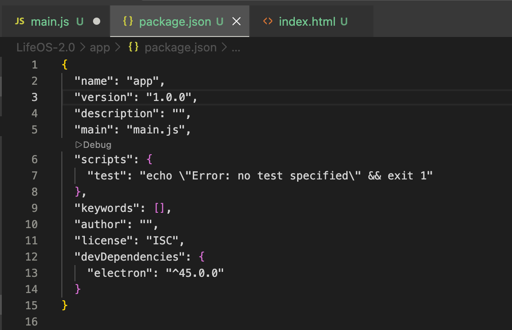
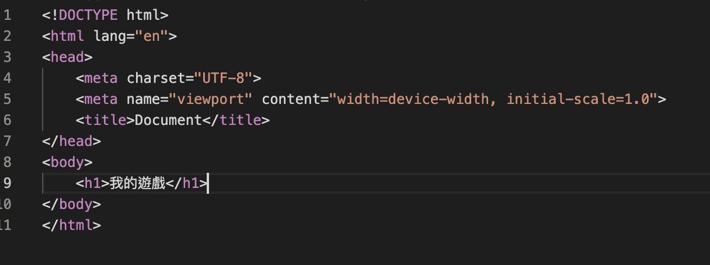
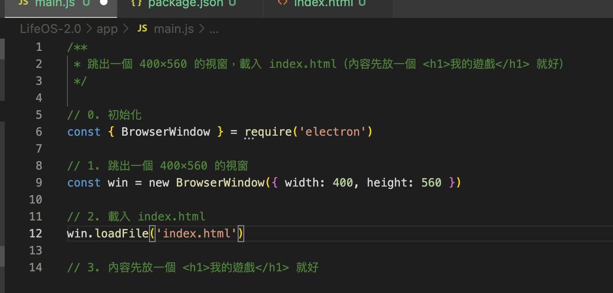
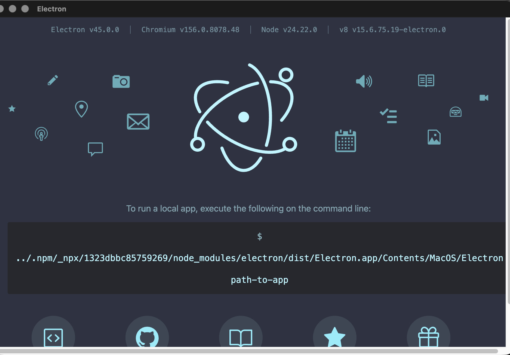
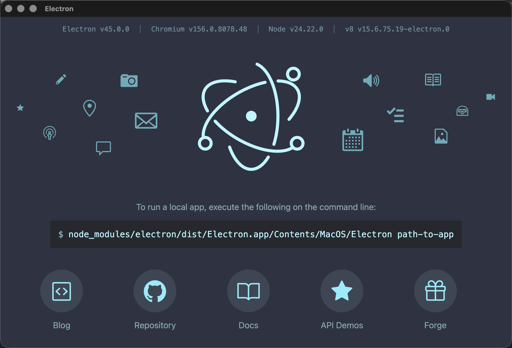
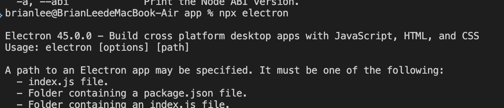
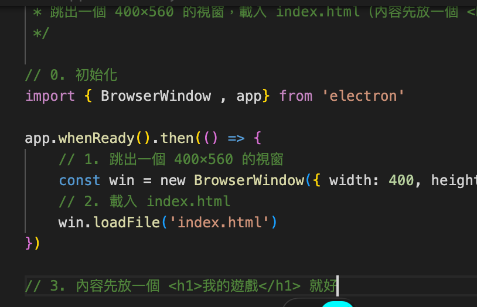

# Electron 學習日誌

用 Electron 從零做 LifeOS 桌面應用，記錄每一步遇到的問題。

## 架構筆記

```
主程序 main.js（Node.js）  ◀── IPC ──▶  畫面 renderer（Chromium）
可讀檔、開視窗、執行指令                  只負責 HTML/CSS/JS 呈現
                 ▲ preload.js：橋接層，只開放指定的函式給畫面
```

| 步驟 | 內容 | 狀態 |
|---|---|---|
| 1 | 建專案、開出一個空視窗 | ✅ 2026-10-25 |
| 2 | `games.js`：讀資料夾、解析 frontmatter | |
| 3 | IPC + preload：把資料送到畫面 | |
| 4 | 畫面渲染清單、點擊在 VS Code 打開 | |
| 5 | `fs.watch` 自動刷新 | |

---

## 2026-10-25 步驟 1：開出空視窗

### 我寫的程式

`package.json`：`main` 指向 `main.js`，安裝了 `electron@^45.0.0`



`index.html`：



`main.js`：



### 問題：跑出 Electron 預設歡迎頁，不是我的畫面



### 原因

1. **在錯的資料夾執行指令。**畫面上的路徑是 `../.npm/_npx/.../Electron`，代表 npx 找不到專案裡的 Electron，臨時下載了一份，而且 `.` 指向的資料夾沒有 `package.json`。當時是在 `~/Project` 執行，不是在 `LifeOS-2.0/app`。Electron 沒拿到 App 時，就會顯示這個歡迎頁。
2. **`main.js` 還沒存檔。**分頁上有白點，硬碟上的 `main.js` 是 0 bytes。
3. **`BrowserWindow` 建立得太早。**`app` 還沒 ready 就 `new BrowserWindow()` 會報錯：`Cannot create BrowserWindow before app is ready`。必須等 `app.whenReady()` 之後再開視窗。

### 學到的事

- `npx electron .` 的 `.` 是「目前資料夾」，要在有 `package.json` 的那一層執行
- 看到 Electron 歡迎頁＝ Electron 沒有載入任何 App，先檢查路徑
- Electron 的生命週期：先 `app` ready，才能建立視窗
- 可以在 `package.json` 加 `"start": "electron ."`，之後用 `npm start`，就不會跑錯 Electron

### 第二次嘗試：還是歡迎頁

已經改到 `app/` 執行，`main.js` 也存檔了，但畫面還是一樣。




**進步了：**指令列的路徑變成 `node_modules/electron/...`，代表這次用的是專案裡的 Electron。

**原因：**執行的是 `npx electron`，**少了最後的 `.`**。沒指定 App 路徑時，Electron 一樣會顯示歡迎頁。終端機的訊息也寫了：`Usage: electron [options] [path]`。

**接下來會遇到的兩個錯誤：**

1. `main.js` 用了 `import`，但 `package.json` 沒有 `"type": "module"`，Node 會用 CommonJS 解析，結果是 `SyntaxError: Cannot use import statement outside a module`
   - 二選一：改用 `require('electron')`，或在 `package.json` 加 `"type": "module"`
2. 前面提到的 `app` 還沒 ready 就建立視窗的問題

### 學到的事（第二次）

- Electron 的歡迎頁＝沒拿到 App，可能是「路徑錯」或「沒給路徑」
- 錯誤訊息和 Usage 說明要讀完，答案常常就寫在上面
- Node 的模組系統有兩種：CommonJS（`require`）和 ES Module（`import`），由 `package.json` 的 `type` 欄位決定用哪一種

### 修正後：成功 🎉

修法：在 `package.json` 加 `"type": "module"`，並用 `app.whenReady().then(...)` 包住建立視窗的程式碼。




---

## 2026-10-25 重構：main.js 不想塞所有流程

### 想法

`main.js` 只當「目錄」，描述 App 的生命週期；每件事交給各自的模組。

```
app/
├── main.js              # 入口：只負責組裝
└── src/
    ├── main/            # 主程序（Node.js）
    │   ├── window.js    # 建立視窗
    │   ├── games.js     # 讀 games/*.md（步驟 2）
    │   └── ipc.js       # 註冊 IPC handler（步驟 3）
    ├── preload.js       # 橋接層（步驟 3）
    └── renderer/        # 畫面
        └── index.html
```

### 其他建議

- 註解別重述程式碼。檔頭寫 400×560，程式碼卻是 700，註解很容易和程式碼對不上
- ES Module 沒有 `__dirname`，要改用 `import.meta.dirname`（Node 20.11 以上），組出絕對路徑
- `<title>Document</title>` 會直接顯示在視窗標題列

### 已完成

- 加上 Prettier：`app/.prettierrc` 設定成不加分號、單引號；`~/Project/.vscode/settings.json` 開啟存檔自動格式化（JS／JSON／HTML／CSS）；也可以用 `npm run format` 一次格式化全部
- 新增 `npm start`
- `main.js` 整理成一個 `createMainWindow()`，用 `import.meta.dirname` 組出絕對路徑，關掉所有視窗時結束 App

### 又踩到的坑

- **設定放錯層：**VS Code 只讀「開啟的那一層」資料夾裡的 `.vscode/settings.json`。我開的是 `~/Project`，設定放在 `LifeOS-2.0/.vscode/` 不會生效
- **未存檔的編輯器蓋掉硬碟上的修改：**別人（或 AI）改了檔案，但 VS Code 裡還開著舊版本，這時按存檔就會把新版本蓋掉。遇到時用 **File: Revert File** 重新從硬碟載入
